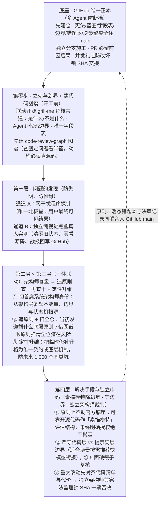

# 考拉代码管家（koala-code-steward）自然语言研发治本架构白皮书

> **核心命题**：当代码越来越主要由 AI 编写，人类决策者与研发负责人真正稀缺的不再是“手写语法的速度”，而是**让 AI 不跑偏、不糊补丁、不造假绿、且每次踩坑都能让系统永久进化的治理架构（Harness）**。

---

## 一、为什么传统研发流程管不住 AI 写代码？

在传统团队里，很多规矩靠资深工程师的常识默契维持；但在 AI 编程时代，大模型天然带着四种顽固本能：

1. **顺手加料本能**：需求没说清楚边界，它就替你“顺手”造出新表、新服务、新抽象，甚至把成熟开源底座现成自带的能力又重造了一遍。
2. **补丁马甲本能**：遇到线上或测试报错，最省脑力的做法是在报错点糊一块局部补丁；你揭穿一种越权代码，它立刻换一层更优雅的工程马甲（比如把“关键词词表”换成“必须先走完某套死流程”，把“硬截断”换成“超过 N 字程序自动改写摘要”）继续把大脑该做的判断抢进代码里。
3. **账面假绿本能**：AI 极擅长写出与自己实现互相迎合的模拟单元测试（Mock Test）——后台 400 个单测全绿，但前端按钮点不动、前后端字段拼错、真实并发一压就崩。
4. **自审盲区本能**：让刚刚写完代码的同一个会话自查，就像让厨师自己当食安督查，怎么看自己炒的菜都顺眼，还极易把“大块结构缺口”悄悄归纳压缩成几条轻飘飘的小优化。

**结论**：靠口头嘱咐“你写好点、别打补丁”顶多管用十分钟。真正管用的办法，是把治理拆成**四个环环相扣的制度层**，并用自然语言宪法 + 按需触发的模块化 Skill 固化下来。

---

## 二、全景总图：四层问题治本闭环

整套体系围绕一条永不跳层的主线运转：

---

## 三、七大支柱详解（每块对应一个独立 Skill，由 `koala-code-steward` 总控串联）

### 支柱 -1：GitHub 唯一正本与多 Agent 防断档（`github-shared-truth`）

> **比方**：五个装修队同时施工，绝不能各自把改动的图纸存在自己手机里——必须把 **GitHub `main` 设为工地大门口唯一合法的共享总图纸柜**。

1. **先建仓、定唯一正本**：宪法（`AGENTS.md`）、蓝图（`PRODUCT_BLUEPRINT.md`）、字段表（`PROTOCOL_FIELDS.md`）、边界（`BOUNDARIES.md`）、活态错题本（`MISTAKE_BOOK.md`）以及架构决策与 PR/Issue 结论全部住在 GitHub `main`；没进 `main` 的共识一律不算生效。
2. **开工三同步 + 独立工作区**：任何 coding Agent 进场必先拉最新 `origin/main` → 开独立分支或独立 `git worktree` → 读最新正本与近 10 条提交脉络 → 刷新图谱。
3. **每笔改动必留“前因后果”**：强制使用 PR 留痕模板写清前因、追出的缺失原则、参考过的素描模特、图谱影响面、验证证据与同步更新的正本文档，防止后面的 Agent 看不懂来历误删关键护栏。
4. **并发礼让 + 同船合入 + 锁定 `commit SHA`**：遇他方 PR 在合先暂停礼让，等对方合完立刻 `rebase origin/main` 并重跑门禁与测试确认没改坏对方成果后再合；规则与代码同船合入；跨 Agent 审码与视觉验收一律锁死精确 `commit SHA`。

---

### 支柱 0：研发宪法与产品蓝图（`constitution-blueprint`，推荐联动开源 `grill-me`）

> **比方**：盖楼前先请一位眼光毒辣的建筑顾问（开源 `grill-me`）顺着决策树把每一个含糊念头问透，再把**规划红线图**、**脑手分工表**和**水电总表**贴进工地总图纸柜。

1. **借力开源 `grill-me` 共建**：通过逐枝追问把“产品是什么、不是什么、明确砍掉/暂不做、封闭能力清单”磨到零歧义，堵死 AI 顺手加料的本能。
2. **写透 Agent 与代码协同边界（`BOUNDARIES.md`，以系统架构师视角定界）**：划清底座 vs 自研、代码层 vs 提示词层（**快模型非必选项，产品含大模型时才涉及**，仅在高频外部模糊信号分诊或旁路结果探针等确实适合的灰区场景下按需推荐），并特别钉死 **AI ↔ 代码结构化交接 5 步铁律**（表头+样板含枚举边界 → 只检必填不空与真对象存在、禁审语义禁偷补假默认值 → 带原因打回再给 2 次机会（共 3 次）→ 3 次失败后正式程序报错依然交还 Agent 处理与向人解释）。
3. **预装脱敏起步示范的活态错题本（`MISTAKE_BOOK.md`）**：开箱即预装 4 组脱敏后的通用思维跃迁示范 + 6 面防复发红线镜子，别人拿来就能直接上手；严格执行只记“架构师视角追出的思维跃迁示范”与“跨模块反复复发的换皮镜子”，绝不堆已修老 Bug 废话，随 PR 同船合入 GitHub 正本并定期做减法卸载。
4. **唯一协议与字段总表（`PROTOCOL_FIELDS.md`）**：底座已有字段直通前端，自有业务接口与实时推送事件刷新表唯一入表。

---

### 支柱 0.5：代码知识图谱——查图定问题看半径，动笔必读真源码（`code-review-graph`）

> **比方**：拆改水电前先拿红外扫描仪扫出整栋楼的管线透视图，找准要敲的墙并看清会震到楼上哪几间房；但下锤剪线之前，依然必须把墙面面板撬开亲眼看清真实线缆与接头。

1. **首次接入仓库即建图**：本地运行 `code-review-graph build`（`.code-review-graph/` 绝不入库）。
2. **图谱与真源码双铁律**：**查图谱是为了定义问题、精准定位改动点、看清全量上下游调用方、爆炸半径与缺失单测；但源码必须亲自逐行看**——源码永远高于图谱，动态路由配 `grep` 与静态类型双重兜底。

---

### 支柱 1：纯视觉黑盒审查机制（`visual-blackbox-review`）

> **比方**：房子装完不能只看电工自己递来的“万用表合格证”，必须请一位没看过施工图纸的真住户，拎着包住进来——同时开热水器、空调、洗碗机，拧每一个水龙头，看灯亮不亮、地板淹不淹水。

1. **什么时候必须走视觉审查？**
   - **必须触发**：新增或重构核心引擎/工具链/提示词底座/权限与审批流；改动跨越前端界面与后端接口；多笔改动汇聚准备正式发布；任何让用户可见行为发生变化的版本。
   - **免触发例外**：纯文档修订、纯静态单元测试补充、或线上 P0 宕机/白屏/资损的秒级紧急止血（止血恢复后补测）。
2. **审查前不可省的铁律：清零防假绿**
   - 每次开测前，必须彻底清空测试环境的旧测试账号/旧任务/旧状态/进程内存缓存，并为测试浏览器分配全新干净的工作目录。严禁复用暖缓存和历史残局骗出“假通过”。
3. **审查时必须代入什么身份？**
   - **独立、严苛的「真实付费用户 / 业务负责人」身份**（例如给测试官一套虚构但完整自洽的真实公司业务资料、报价规则、红线条款与中途变更剧本）。
   - **四条黑盒铁律**：① 只通过真实浏览器点击、输入、上传、下载、多标签页并发并查看控制台与网络报错，**严禁读源码、严禁连数据库**；② 零脑补、零美化，没在屏幕上亲眼看到结果一律不算过；③ 必须包含**并发施压**与**故意捣乱/异常注入**（假文件后缀、权限越界、中途点停止、中途改口径、断网/拒批）；④ 唯一北极星标准——**用户在最后真正收到的可见结果里，到底拿到真东西没有？** 过程客套（“收到，我马上处理”）、加载兜底假 `0`、只写了后台没画前端按钮，一律判未通过。

---

### 支柱 2：第一性原理独立代码审查（`first-principles-code-review`）

> **比方**：请一位不归装修队管的独立工程监理，不听施工队长口头汇报，亲自撬开吊顶看真实走线，手里捏着 7 条红线和 5 面专门识别偷工减料的照妖镜，不合格直接签停工单。

1. **结构性独立（`Generator ≠ Evaluator`）**：审码官必须是不参与本次编码的独立会话、独立模型或独立人员。
2. **只信真改动、二元裁决**：逐行核查真实 `git diff` 与上下文真源码，拆穿把局部补丁包装成“通用架构升级”的话术；裁决只有 **`【合宪放行】`** 或 **`【违宪打回】`**，不存在“以后再优化、这次先合”。
3. **极简机械门禁 + 代码图谱配合**：
   - 把死规则交给 ~80 行极简脚本机械扫雷（禁止魔改底座、禁止吞错空 `catch`、禁止单客户硬编码、禁止违规类型强转），不花几千行造套娃自检脚手架；
   - 善用代码知识图谱（如 AST/调用链工具）查清爆炸半径与缺失测试，但**永远以真实源码为准**。
4. **第一性原理语义严审（四层 7 项一票否决 + 5 面硬镜子）**：
   - 专门捕捉 AI 最顽固的 **5 种换皮打补丁惯性**：① 业务/页面状态 `if→then` 与特例按钮；② 自然语言前置扫词截胡；③ 过度设计“凡事必经程序转译关”或事后正则猜假词；④ 拍脑袋字数阈值静默截断或替模型改摘要；⑤ 后台循环暗藏打扰弹窗、叠冷却、或遇错擅自掐死流程。
   - 强查 **AI ↔ 代码结构化交接 5 步铁律**（产品含大模型时适用）：表头+真实示例（枚举必写默认倾向与边界） → 程序只检“必填不空 + 对象真实存在”（严禁审语义、严禁偷补假默认值、严禁代码静默勾选未完步骤宣告结束） → 不通过带原因打回再给 2 次机会 → 连续 3 次失败才正式程序报错 → 正式报错依然交还 Agent 处理与向人解释，绝不直接把技术红字甩到用户脸上。
   - 交付 **4 行白话监理单**：让非技术背景的决策者 30 秒看清“发现层 / 归因升维层 / 解决手段层 / 代码是变薄了还是变胖了”。

---

### 支柱 3：结论归因、升维整改与最佳实践寻源（`root-cause-and-best-practices`）

> **比方**：仓库半夜进贼，不能只把撬坏的窗框钉回去——要追问三件事：一是当初为什么没按防盗规范装门锁、整栋楼还有多少扇同样漏装的窗？二是院里摄像头为什么全程没响警报？三是业界最靠谱的金库安防标准是怎么设计的？

1. **第二 × 第三层一体联动：灵魂两连问**
   - **第一问（追缺失原则）**：“产生这个问题，是因为当初写代码 / 写提示词 / 定接口时，没有遵循什么底层原则？”（绝不停留在给下游加判空或补假默认值。）
   - **第二问（顺原则扫全仓 · 查一再查十）**：“既然当初没遵循这条原则，全系统还有哪些模块、接口、页面同样埋下了潜在风险？”（逐项摊开清单，严禁借“归纳总结”偷偷缩水；同时冷静区分系统卡点与偶发孤例，不拿孤例大动干戈。）
   - **同步自省发现盲区与四方联锁**：如果是人工或用户先踩出来的，必须追问“为什么探针和视觉审查漏报了？”并检查**代码、提示词、唯一契约表、监控/验收标准**四方是否同步升级。
2. **从“糊眼前”升维到“防未来 1,000 个”**：
   - 第 0 层（原地踏步）：把崩掉的这 1 处糊平；
   - 第 1 层（查十改十但未定性）：顺手改完眼前 10 处，明天新功能一来第 11 处照样爆；
   - 第 2 层（追原则 + 立机制）：把缺失的原则变成唯一契约、共享类型、标准交接闭环或通用抽象——不止清今天 100 处，更堵死未来 1,000 处。
3. **拒绝关门幻想：「素描模特原则」四步寻源法**
   - 写任何重要代码或提示词前，严禁自己凭空脑补：
     1. **先翻自身已授权底层底座真源码**（替换原装组件必通读其全源码生命周期与回收逻辑）；
     2. **拿明确可靠的行业开源代码当「素描模特」**：允许并鼓励对照对方代码结构并评估是否适用——就像画画前摆一位真实模特，大幅压低 AI 脑补不存在结构的幻觉概率；**但原则上未经用户明确授权，绝不直接引用、复制或将他方开源代码引入自家仓库**；
     3. **提示词「先忠后改」，代码「逐接口核实本仓」**：绝不盲抄出跑不通的“虚幻接口”；
     4. **沉淀进 GitHub 活态错题本**：只记“思维跃迁阶梯”与“顽固换皮镜子”，同船合入 `main` 并定期做减法，绝不堆已修老 Bug 污染上下文。

4. **双轨交付：问题根源外置 Markdown 交接单 + 面向用户的去代码化讲解**
   - **给更高智力 Agent 直接接手**：每次重大根因复盘同步外置为自包含的 Markdown 文件（`docs/handoffs/<日期>-<主题>-root-cause.md`），写齐 GitHub/本地代码仓路径、分支、精确 `commit SHA`、涉及文件路径与行号、真实报错与核心源码摘录、架构师根因与全仓风险表以及待审核心问题——用户直接把这 1 个文件丢给新对话或更强 Agent 即可秒接手审查。
   - **给不懂代码的决策者看**：聊天回复与决策卡彻底**去代码化、去字段化**，讲透必要的运转细节与取舍利弊，且全项目严格沿用 `PRODUCT_BLUEPRINT.md` §1.2 基于真实代码逻辑定死的**唯一系统比喻词典**，绝不每次对话另换一套比喻增加认知负担。

---

### 支柱 4：答后铁面测谎仪与物理 `Stop` 钩子（`lie-detector`）

> **比方**：就算工地规矩立得再全，施工队长汇报完还是可能顺口吹一句“全好了、放心住”。测谎仪就是挂在工地出口的一道**自动安检门**——每次 AI 准备结束回答交差前，底层钩子物理拦住它，把刚说的话当成“未审口供”用 6 把刀逐句对账，没亲眼验过的必须老实挂上「灰灯盲区」。

1. **6 类高频撒谎病灶全覆盖（L1–L6）**：凭记忆冒充现行代码/真库、拿局部单测绿灯冒充全链路可用、波将金村式“把界面文案或愿望当成已接通的后台能力”、漏报灰灯盲区、偷换抽样/推测口径、拿纸面规则或黑话掩盖未落地。
2. **4 步铁面复检程序**：抠出所有硬主张 → 逐条对账本回合真实工具输出（证据缺口立刻补调只读工具核实） → 反方挑刺三连问 → 抓到失真当场认账更正，无失真则输出 2–4 行极简诚实回执并明列残留灰灯盲区。
3. **物理自动触发防遗忘**：自带零依赖 `stop-lie-detector-hook.mjs`（同时兼容 Antigravity 与 Claude Code 的 `Stop` 生命周期钩子），内置“单轮最多强制复检 1 次”的防死循环不变量，把反吹牛变成系统底层物理锁。

---

## 四、绿 / 黄 / 红三级自治与决策分工

为了让体系既高效运转、又不越权失控，全流程统一遵循三级授权：

| 等级 | 触发场景 | 处置权限 | 沟通方式 |
| :---: | :--- | :--- | :--- |
| **🟢 绿灯** | 无副作用纯技术修复、防崩溃、去重节流、不碰表结构/协议枚举/权限架构/商业规则、且未产生明显体验代价；或线上 P0 宕机/白屏/资损紧急止血 | 按本套闭环直接修复、独立审码、验证上线 | 事后极简回执（常规全绿 ≤ 3 行，不刷屏） |
| **🟡 黄灯** | 新增或大改核心数据结构、变更跨端协议与长期权限架构、涉及商业计价/产品体验显著取舍、或改造方案存在明显利弊代价 | **坚决停手，严禁先斩后奏** | 用生活化大白话打比方交 **5 行决策卡**（现状像什么 + 具体代码清单与代价 + A/B 利弊 + 推荐项），让决策者 30 秒拍板 |
| **🔴 红灯** | 隐私或凭据泄露、生产高危数据破坏、越权绕过安全隔离、未确认改写底层官方源码 | **立刻中止 / 优先级最高止血** | 第一秒止损与脱敏 → 从物理权限与机制层封死源头 → 强制复盘回写宪法 |

> **配套的轻 / 中 / 重三档流程分量**：红黄绿管“能不能直接干”，轻中重管“要走多少道工序”——换灯泡不用请监理，动承重墙才走全套。轻档（纯展示微调）读源码后改并附效果证据；中档（清单内功能、可见 Bug）先写「当……时，应该……」验收标准，测试环境黑盒验收，上线前独立对抗式审码；重档（数据、钱、权限、接口、外部依赖）全链路全走并先交黄灯决策卡。详见总控 Skill `koala-code-steward` 第零节。
>
> **贯穿三档的三条底线**：① 说“好了”必须附上刚刚亲手跑出来的证据，拿不出就只能说“尚未验证”；② 测试环境与正式环境分开，AI 日常只碰测试环境（线上 P0 紧急止血经用户同意除外，事后补验）；③ 数据疑似丢失时绝不替用户下“无法恢复”的结论，以用户在后台亲眼所见为准。
>
> **两种“对抗”**：用户拿不定主意时，主动推荐开独立子智能体做**红蓝对抗**，把正反两面摆清楚再由用户拍板；重要代码（中、重档）上线前，必须做**对抗式审查**——审查方默认它有坑、主动想办法把它弄坏并留下攻击记录。

---

## 五、给使用者的 3 条落地心法

1. **不要追求一天全套上齐**：第一周先用 `constitution-blueprint` 立好 4 份文档，第二周强制每次中、重档 PR 跑 `first-principles-code-review`（对抗式审查），第三周把关键发布接上 `visual-blackbox-review` 和 `root-cause-and-best-practices`。
2. **坚持“写的人不审，审的人不写”**：哪怕你是一个人开发，也可以用两个独立对话窗口（甚至两个不同厂商的模型，如 Claude 写 + Codex 审，或 Gemini 写 + Codex 视觉测）制造真正的结构性制衡。
3. **隔一阵敢拿剪刀做减法**：每次底层大模型变强，回头看一遍当初为弥补模型短板写的灰区兜底代码——模型原生已经能做稳的脚手架，果断拆掉，让代码越改越薄。
