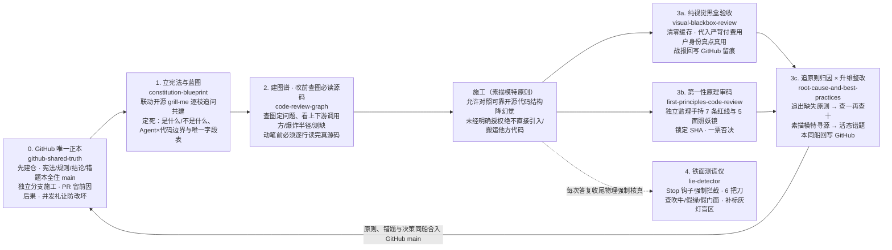

# 考拉代码管家（koala-code-steward）

> **用自然语言宪法、GitHub 唯一正本与模块化 Skill，真正“套住”多 Agent 写代码的全过程——不靠盲目堆补丁，靠建仓同源、共建蓝图、图谱定位看源码、素描模特降幻觉、真眼验、独立审、架构师追原则。**

[](#跨工具安装与开箱即用)
[](LICENSE)

用 AI（尤其是多个并发 AI Agent）写代码，最让人崩溃的往往不是“AI 写不出来”，而是下面五个反复上演的怪圈：

1. **多 Agent 各自为战、互相改坏造成断档**：甲 Agent 改完没留前因后果、把规则留在自己聊天框里，乙 Agent 转头把甲刚修好的护栏当冗余删了，两边彻底断档。
2. **爱自由发挥、凭脑子空想造幻觉**：需求边界模糊时 AI 顺手造一堆清单外功能；没看可靠开源“素描模特”结构就凭空脑补，造出复杂难用的轮子。
3. **一出错就糊补丁，揭穿一次换件马甲接着糊**：删了业务关键词表，它改成硬编码流程锁；删了硬截断，它改成拍脑袋字数阈值——补丁越叠越厚，最后谁都不敢动代码。
4. **账面单测全绿，一真用全露馅**：几百个模拟单测全绿，打开真实浏览器像普通用户一样点两下，页面白屏、按钮点不动、前后端字段全错位。
5. **厨师自己当食安督查**：同一个 AI 写完代码自己给自己点赞，既不追问当初没遵循什么原则，也不扫清全仓同类隐患，下周同一个坑换个地方继续炸。

**考拉代码管家（`koala-code-steward`）** 是一套从真实高强度多 Agent 研发实战中提炼出来的**开源自然语言研发治理（Harness）Skill 套件**，**专为不懂代码、靠 AI 做开发的人设计**：你只管用大白话说要做什么，它负责让 AI 按规矩施工、在测试环境验收、拿证据说话，并用你听得懂的比方向你汇报。它遵循开源 [Agent Skills](https://agentskills.io) 标准，装进 **Claude Code、OpenAI Codex、Cursor、Antigravity、OpenCode** 即可直接用起来。

---

## 一句话理解整套体系：把 GitHub 当成唯一共享总图纸柜



| 模块 | Skill 目录 | 解决的核心痛点 | 关键交付物 |
| :--- | :--- | :--- | :--- |
| **总控导航** | [`skills/koala-code-steward/`](skills/koala-code-steward/SKILL.md) | 串联全流程、按**轻/中/重三档**匹配流程分量、按阶段路由 7 大专职子 Skill、界定绿/黄/红决策边界、**说“好了”必附刚跑出的证据**与去代码化统一比喻沟通纪律 | 全链路调度、三档流程表、红黄绿拍板卡 |
| **0. GitHub 正本与多 Agent 防断档** | [`skills/github-shared-truth/`](skills/github-shared-truth/SKILL.md) | **先在 GitHub 建仓**，把宪法/蓝图/规则/结论/错题本统一托管为唯一正本；独立分支/worktree + PR 前因后果 + 并发礼让 + 同船合入 + 锁定 SHA 交接，确保多 Agent 绝不互相改坏断档 | `.github/pull_request_template.md`、`docs/decisions/` ADR 模板 |
| **1. 研发宪法与产品蓝图** | [`skills/constitution-blueprint/`](skills/constitution-blueprint/SKILL.md) | **推荐联动开源 `grill-me` 共建**：明确产品**是什么、不是什么**、封闭能力清单、**「当……时，应该……」验收标准**、唯一协议字段表、**Agent 与代码协同边界（含 5 步交接铁律）**及**活态错题本积累机制** | `AGENTS.md`、`PRODUCT_BLUEPRINT.md`、`PROTOCOL_FIELDS.md`、`BOUNDARIES.md`、`MISTAKE_BOOK.md` |
| **2. 代码知识图谱（查图 + 必看源码）** | [`skills/code-review-graph/`](skills/code-review-graph/SKILL.md) | 先为代码仓建本地知识图谱；每次改代码前查图以**定义问题、定位改动点、看清上下游调用方、爆炸半径与缺失单测**，并**强制亲自逐行读完真源码后再落笔** | 本地代码图谱、影响面与单测缺口报告 |
| **3(a). 纯视觉黑盒审查** | [`skills/visual-blackbox-review/`](skills/visual-blackbox-review/SKILL.md) | 界定**什么时候必须走视觉审查**、**只在与正式环境分开的测试环境上测**、**清零防缓存假绿**、**逐条对照验收标准**、以及**代入真实付费用户身份**做纯黑盒并发压测与唯一结果北极星判定，战报锁 SHA 回写 GitHub | 视觉验收指令单、分级缺陷单、零干扰异常信号表 |
| **3(b). 第一性原理代码审查** | [`skills/first-principles-code-review/`](skills/first-principles-code-review/SKILL.md) | 干活与验收分离（`Generator ≠ Evaluator`），重要代码上线前必做**对抗式审查**（默认有坑、主动把它弄坏并留攻击记录），独立审码官凭**四层 7 项一票否决（含素描模特红线与防断档检查）**、**5 面换皮补丁镜子**与极简机械门禁硬核把关 | `【合宪放行】/【违宪打回】` 判决书 + 4 行白话监理单 |
| **3(c). 结论归因、架构师升维与素描模特** | [`skills/root-cause-and-best-practices/`](skills/root-cause-and-best-practices/SKILL.md) | 审出问题后**不糊表面补丁**：先切换**首席系统架构师**身份从架构层复盘根源 → 灵魂两连问（追缺失原则 → 全仓查一再查十）+ **「素描模特原则」**（先看可靠开源代码结构降幻觉，未经授权绝不直接搬运）+ 预装脱敏示范的活态错题本迭代 | 架构归因单、根源外置交接单、素描模特对照结论 |
| **4. 铁面测谎仪（答后强制核真）** | [`skills/lie-detector/`](skills/lie-detector/SKILL.md) | **防 AI 吹牛、凭记忆瞎说、拿局部绿灯冒充全链路可用、拿波将金村假门面当已接通**：内置 6 把刀铁面核查 + 双平台物理 `Stop` 钩子脚本，每次回答结束自动拉起复检并强制补标「灰灯盲区」 | 极简「🔍 测谎仪复检」回执、Antigravity / Claude Code `Stop` 钩子脚本与模板 |

---

## 跨工具安装与开箱即用

本套件遵循开源 **Agent Skills** 规范（`SKILL.md` + `references/` + `templates/`），按需渐进加载，不浪费上下文。

### 1. 一行命令直接装齐全部 8 个 Skill（最推荐）

```bash
npx skills add zhaokoala340/koala-code-steward
```

> 自动识别你电脑里的 **Claude Code、OpenAI Codex、Cursor、Antigravity、OpenCode** 等主流 AI 编程工具，一条命令把全部 8 个 Skill（含内置模板、预装错题本与双平台物理测谎仪钩子脚本）装到位。也可以按需只装单个 Skill，例如 `npx skills add zhaokoala340/koala-code-steward --skill lie-detector`。

<details>
<summary>备选方式：手动克隆并用脚本安装（适合离线或批量装入多个目录）</summary>

```bash
git clone https://github.com/zhaokoala340/koala-code-steward.git
cd koala-code-steward

# 安装到目标项目的 .claude/skills / .agents/skills 等目录（团队随 Git 共享）
./install.sh --target all --scope project --project-dir /path/to/your-project

# 或者安装到本机全局（适用你电脑上的全部项目）
./install.sh --target all --scope global
```

</details>

### 2. 推荐配齐两个开源搭档工具（1 分钟装完）

```bash
# 搭档 A：代码知识图谱引擎（实现“先建图、改前查图看半径”）
uv tool install code-review-graph
code-review-graph install
cd /path/to/your-project && code-review-graph build

# 搭档 B：开源 Grill-Me 访谈 Skill（用于立项阶段逐枝追问共建宪法与蓝图）
npx skills@latest add mattpocock/skills --skill=grill-me
```

### 3. 让 AI 把调用约定写进你项目的 `AGENTS.md`（防止新对话漏用）

装好后第一次在项目里对话时，总控 Skill 会**主动询问**你：要不要把本套 Skill 的调用约定写进项目根目录的 `AGENTS.md`。建议同意——写进去之后，以后任何新对话、任何 AI 一进项目都会自动按这套流程干活，不会漏用。

### 常见启动日志：`Mode 'bypass' is not available in sandbox sessions`

这不是本套件安装失败，也不是 Skill 内容报错；它表示 ACP 客户端试图把 Devin CLI 切到 **Bypass（全部自动批准）**，但当前会话启用了 OS 级 `--sandbox`。沙箱像“带护栏的操作台”：既然已经有护栏，Devin 只提供 **Autonomous** 模式，`bypass` 会被拒绝。

按启动方式二选一：

```bash
# 沙箱会话：使用 autonomous（通常也会自动选中）
devin --sandbox --permission-mode autonomous

# 非沙箱会话：才可使用 bypass
devin --permission-mode bypass
```

启动日志里的 `loaded=148 by_provider=[...]` 只是扫描到的 Skill 数量统计；`errors=1` 表示另有一条 Skill 加载失败，需要看更完整日志定位，它与上面的 `bypass` 拒绝不是同一件事。若不希望 Devin CLI 继承 Codex 等工具的 Skills，可在 Devin 配置中关闭对应 `read_config_from` 来源。

---

## 5 分钟跑通第一轮闭环

1. **先在 GitHub 建仓，挂好共享正本与留痕模板**：启用 `github-shared-truth`，建仓并放入 `.github/pull_request_template.md`（暂时用不了 GitHub 时，按该 Skill 第三节的入门模式起步）；同时让 AI 帮你**开辟一套与正式环境分开的测试环境**。
2. **联动 `grill-me` 共建研发宪法与产品蓝图**：启用 `constitution-blueprint`，磨清产品是什么/不是什么、「当……时，应该……」验收标准、Agent 与代码边界、唯一字段总表与错题本规则，合入 GitHub `main`。
3. **建图谱、改前查图并亲自读真源码**：启用 `code-review-graph`，查清调用链、爆炸半径与缺失单测，逐行读完目标与关联源码；遇经典机制按**素描模特原则**对照可靠开源结构降幻觉（未经授权不搬运）。
4. **独立审码 + 清零纯视觉验收**：另开独立会话跑 `first-principles-code-review`（锁 SHA 签发判决），涉用户可见链路跑 `visual-blackbox-review`（清零缓存、代入严苛付费用户）。
5. **追原则升维、同船回写 GitHub 正本**：任何缺陷交由 `root-cause-and-best-practices` 追原则、全仓查一再查十，并把原则与思维跃迁同船合回 GitHub `main`。

---

## 仓库目录全景

```text
koala-code-steward/
├── .github/
│   └── pull_request_template.md               # 本仓自用的 PR 前因后果与正本同步模板
├── .gitignore                                 # 严格排除 .code-review-graph/ 与本地密钥
├── README.md                                  # 本文件：快速上手与全景地图
├── ARCHITECTURE.md                            # 考拉代码管家自然语言研发治理架构白皮书
├── LICENSE                                    # MIT 开源协议
├── install.sh                                 # 跨工具一键安装脚本
└── skills/
    ├── koala-code-steward/                    # 总控导航 Skill（全流程编排 + 红黄绿决策）
    │   └── SKILL.md
    ├── github-shared-truth/                   # 0. GitHub 唯一正本与多 Agent 协同防断档 Skill
    │   ├── SKILL.md
    │   └── templates/
    │       ├── PULL_REQUEST_TEMPLATE.md       # PR 前因后果与正本同步模板
    │       └── DECISION_RECORD.md             # 架构决策留痕（ADR）模板
    ├── constitution-blueprint/                # 1. 研发宪法与产品蓝图 Skill（联动 grill-me）
    │   ├── SKILL.md
    │   ├── references/
    │   │   └── two-boundaries-guide.md        # Agent×代码边界 + 5 步交接铁律 + 错题本运营法 + 正反例
    │   └── templates/
    │       ├── AGENTS_TEMPLATE.md             # 跨对话研发总宪模板（含 §0 Skill 调用约定，复制为项目根目录 AGENTS.md）
    │       ├── PRODUCT_BLUEPRINT.md           # 产品是什么 / 不是什么 / 封闭清单 /「当……时，应该……」验收标准模板
    │       ├── PROTOCOL_FIELDS.md             # 官方优先唯一接口与字段总表模板
    │       ├── BOUNDARIES.md                  # 底座 vs 自研 & 代码层 vs 提示词层（+可选快模型）边界表
    │       └── MISTAKE_BOOK_TEMPLATE.md       # 预装脱敏起步示范的活态错题本模板
    ├── code-review-graph/                     # 2. 代码知识图谱 Skill（先建图 · 查图定位 + 必读源码）
    │   └── SKILL.md
    ├── visual-blackbox-review/                # 3(a). 纯视觉黑盒审查 Skill
    │   ├── SKILL.md
    │   ├── references/
    │   │   └── north-star-and-probes.md       # 唯一结果交付北极星 + 零干扰异常信号总表
    │   └── templates/
    │       └── visual-qa-brief.md             # 通用纯视觉黑盒实测提示词母版
    ├── first-principles-code-review/          # 3(b). 第一性原理宪法审码 Skill
    │   ├── SKILL.md
    │   ├── references/
    │   │   └── five-patch-mirrors.md          # 专抓 AI 换皮打补丁惯性的 5 面原版硬镜子
    │   └── templates/
    │       └── check-gates.mjs                # 极简机械门禁脚本母版（~80 行，拒写套娃脚手架）
    ├── root-cause-and-best-practices/         # 3(c). 结论归因、架构师升维与素描模特寻源 Skill
    │   ├── SKILL.md
    │   ├── references/
    │   │   ├── thinking-leap-ladder.md        # 三组「思维跃迁阶梯示范」（第 0 层 → 第 2 层）
    │   │   └── best-practice-playbook.md      # 「素描模特原则」与行业最佳实践四步寻源手册
    │   └── templates/
    │       └── ROOT_CAUSE_HANDOFF.md          # 问题根源外置 Markdown 交接单（直接丢给高智力 Agent 接手）
    └── lie-detector/                          # 4. 铁面测谎仪 Skill（6 把刀答后核真 + 双平台物理 Stop 钩子）
        ├── SKILL.md
        ├── scripts/
        │   └── stop-lie-detector-hook.mjs     # Antigravity / Claude Code 通用零依赖 Stop 物理拦截钩子
        └── templates/
            ├── antigravity-hooks.json         # Antigravity hooks.json 配置模板
            └── claude-code-hook.json          # Claude Code settings.json Stop 钩子配置模板
```

---

## 延伸阅读

- 完整阅读整套理念、多 Agent 防断档机制、Agent×代码协同边界与活态错题本运营细节：[ARCHITECTURE.md](ARCHITECTURE.md)。
